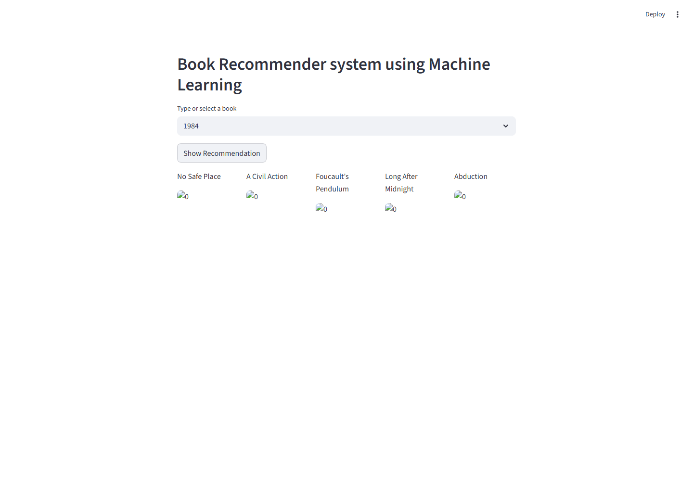
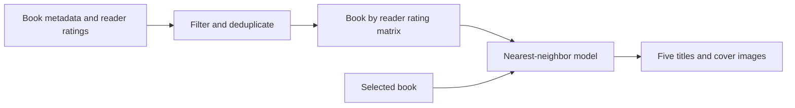

# Book Recommendation System

Discover your next read through an interactive Streamlit app that recommends books with similar reader-rating patterns. Select a familiar title and explore five related books, with titles and cover images.


## Project preview



*Screenshot of the actual Streamlit application. Cover images come from the dataset's external image URLs; availability depends on the image host.*

## Overview

This project implements item-based collaborative filtering on Book-Crossing reader ratings. Each book is represented by its ratings across readers, and a nearest-neighbor model retrieves books with nearby rating vectors. The application uses a selected book as its starting point; it does not require an account or a personal reading history.

The repository includes the data exploration and training notebook, source datasets, saved model artifacts, and an interactive web application.

## Features

- Search or select a title from the trained catalog of **742 books**.
- Request **five book recommendations** with a single button.
- Browse recommended titles and their cover images in a five-column layout.
- Run inference locally using the included model artifacts.
- Inspect and reproduce data preparation and training in a Jupyter notebook.

## How recommendations work

1. Load book metadata and ratings from the `BX-*.csv` files using Latin-1 encoding and semicolon delimiters.
2. Keep readers with **more than 200 ratings**.
3. Join ratings to book metadata by ISBN.
4. Keep book titles with **at least 50 rating records** in the filtered, joined data.
5. Remove duplicate reader/title pairs and build a book-by-reader matrix, filling missing ratings with zero.
6. Convert the matrix to a SciPy compressed sparse row matrix and fit scikit-learn's `NearestNeighbors(algorithm="brute")`.
7. At inference, request six neighbors and display positions 1–5, assuming the first result is the selected book itself.

The included pivot matrix has **742 rows (books) × 888 columns (readers)**. The model uses scikit-learn's default Minkowski metric with `p=2`, equivalent to Euclidean distance; cosine similarity is not configured.



## Technology

| Component | Purpose |
| --- | --- |
| Python | Application and training code |
| Streamlit | Interactive book selector and recommendation display |
| pandas and NumPy | Data preparation, tables, and array operations |
| SciPy | Sparse representation of the ratings matrix |
| scikit-learn | Brute-force nearest-neighbor retrieval |
| Jupyter, Matplotlib, Seaborn | Notebook exploration and model development |
| pickle | Serialization of the trained model and supporting data |

## Run locally

Use **Python 3.11** for the best starting point when working with the historical model. The package metadata permits Python 3.11 and newer, but the saved estimator was created with **scikit-learn 1.3.0**. Loading it with another version can produce compatibility warnings or failures; retraining in your chosen environment is recommended for a reproducible deployment.

```bash
git clone https://github.com/vams2krish/Book-Recommendation-System.git
cd Book-Recommendation-System
python -m venv .venv
```

Activate the virtual environment:

```powershell
# Windows PowerShell
.\.venv\Scripts\Activate.ps1
```

```bash
# macOS / Linux
source .venv/bin/activate
```

Install dependencies and launch from the repository root:

```bash
python -m pip install --upgrade pip
python -m pip install -r requirements.txt
python -m pip install pandas scipy
python -m streamlit run app.py
```

Open the local URL printed by Streamlit, typically `http://localhost:8501`. Select a book, then click **Show Recommendation**.

`pandas` is explicitly needed to deserialize the saved DataFrames. The existing requirements are unpinned, so they do not recreate the original training environment. For an environment matching the saved estimator, use Python 3.11 and install `scikit-learn==1.3.0` with compatible NumPy, pandas, and SciPy versions, or regenerate all four artifacts together.

## Repository layout

```text
Book-Recommendation-System/
├── app.py                          # Streamlit UI and recommendation functions
├── Book Recommender System.ipynb    # Exploration, preprocessing, training, export
├── artifacts/
│   ├── model.pkl                   # Fitted nearest-neighbor estimator
│   ├── books_name.pkl              # Titles available in the selector
│   ├── book_pivot.pkl              # Book-by-reader rating matrix
│   └── final_rating.pkl            # Filtered metadata, ratings, and image URLs
├── dataset/
│   ├── BX-Books.csv                # Book metadata used by the notebook
│   ├── BX-Book-Ratings.csv          # Ratings used by the notebook
│   ├── BX-Users.csv                # Reader data loaded during exploration
│   ├── books.csv                   # Additional copies in the repository
│   ├── ratings.csv
│   └── users.csv
├── docs/images/                    # Project screenshot
├── src/                            # Local package placeholder
├── requirements.txt                # Runtime dependencies and editable package
├── setup.py                        # Package metadata
├── Procfile                        # Historical Heroku launch command
└── setup.sh                        # Historical Streamlit server configuration
```

## Data and model artifacts

The `BX-*.csv` files contain the Book-Crossing dataset. The notebook uses book titles, authors, publication years, publishers, cover URLs, reader IDs, and ratings. `BX-Users.csv` is explored, but reader demographic fields are not used as model features. The other three CSV files are present but are not referenced by the training notebook.

The dataset and cover images belong to their respective rights holders. Review the original dataset's terms before redistributing or using the data commercially. The project does not establish a separate license for third-party data or artwork.

All four pickle files must remain aligned: the estimator's row indices correspond to `book_pivot.pkl`, while `final_rating.pkl` supplies cover URLs. Only load pickle files from trusted sources, because deserialization can execute code.

## Retrain the model

Install the notebook tools in your activated environment:

```bash
python -m pip install jupyter matplotlib seaborn pandas scipy
python -m jupyter notebook "Book Recommender System.ipynb"
```

Run the notebook cells in order from the repository root. Its export cells overwrite the four files in `artifacts/`. Restart Streamlit after exporting so it loads the regenerated files. The `artifacts/` directory is already included in this repository.

## Deployment

The app can run on a host that supports Python and Streamlit. Install its dependencies, include the trusted artifacts, set the working directory to the repository root, and use:

```bash
python -m streamlit run app.py --server.address 0.0.0.0 --server.port 8501
```

Use the port assigned by your hosting provider when required. `Procfile` and `setup.sh` preserve an older Heroku setup; they are not evidence of a currently available hosted demo.

## Limitations and future improvements

- Recommendations reflect rating patterns, rather than plot, genre, or semantic similarity.
- Only titles in the filtered training catalog are selectable; new books need retraining.
- Missing ratings and any existing zero ratings are both represented as zero in the matrix.
- Grouping by title can combine different editions or books sharing the same title.
- The display skips the first neighbor by position; an explicit selected-title exclusion would handle distance ties more reliably.
- Cover links may be unavailable. The current UI does not provide a fallback image.
- The notebook does not report held-out recommendation metrics, so no accuracy or quality score is claimed.
- Dependency locking, automated evaluation, artifact validation, content-based features, and reader-specific recommendations are possible next steps.

## Author and contributions

Maintained by [Vamshi Krishna](https://github.com/vams2krish). Suggestions and contributions are welcome through GitHub issues and pull requests.

## License

There is currently no standalone `LICENSE` file in this repository. Although the original package metadata mentions MIT, explicit licensing terms should be added before treating the project code as MIT-licensed. Third-party dataset and image rights are separate.
